# NEXTERA — La plateforme B2B qui relie fournisseurs et boutiques

> Catalogue, commandes, livraisons, paiements, facturation électronique conforme au droit tunisien et litiges — dans une seule plateforme web, mobile et PWA.

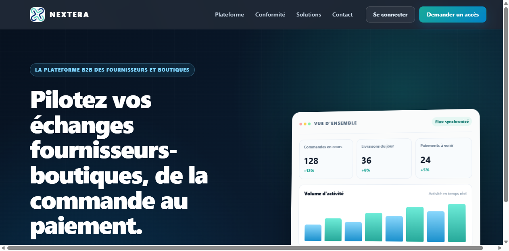

## Le problème

Les échanges entre fournisseurs et boutiques reposent encore souvent sur des appels, des messages et des fichiers Excel. Résultat : stocks approximatifs, commandes perdues, livraisons non tracées, paiements en retard, factures non conformes et litiges difficiles à suivre.

## La solution

NEXTERA centralise tout le cycle commercial B2B :

- **Un catalogue et des stocks partagés** entre le fournisseur et ses boutiques partenaires.
- **Des commandes et devis versionnés**, avec un cycle de vie complet et traçable.
- **Des livraisons géolocalisées** et une réception confirmée par la boutique.
- **Des paiements automatiques ou manuels**, avec détection des retards.
- **Une facturation conforme au droit tunisien** : TVA multi-taux, FODEC, timbre fiscal, TEIF v1.8.8 et retenues à la source TEJ.
- **Des réclamations unifiées** avec priorités, SLA et messagerie entre les parties.
- **Des notifications temps réel** (SSE, push FCM et Web Push PWA).

## Une plateforme, cinq rôles

| Rôle | Périmètre |
|---|---|
| `SYSTEM_ADMIN` | Administration globale : organisations, utilisateurs, relations, statistiques, audit |
| `SUPPLIER_ADMIN` | Gestion complète du fournisseur : catalogue, stocks, commandes, agents, finances |
| `SUPPLIER_AGENT` | Livreur : ses livraisons, acceptation, géolocalisation |
| `SHOP_ADMIN` | Gestion complète de la boutique : commandes, réception, paiements, litiges |
| `SHOP_AGENT` | Exploitation : livraisons assignées, réception, litiges et devis |

## Le parcours, de bout en bout

1. **Le fournisseur publie** ses produits, ses prix, sa TVA et ses règles FODEC.
2. **La boutique commande** manuellement ou depuis le catalogue, ou demande un devis.
3. **Le fournisseur confirme**, prépare, puis affecte un livreur.
4. **Le livreur géolocalisé** assure la livraison ; la boutique confirme la réception.
5. **Le paiement est créé automatiquement** à la réception acceptée.
6. **La facture PDF et la facture électronique TEIF** sont générées, avec QR et référence externe.
7. **La retenue à la source TEJ** est émise, puis déposée et référencée par la boutique.
8. **En cas de désaccord**, une réclamation est ouverte sur n'importe quelle commande, avec SLA et historique.

## Administration et gouvernance

### Tableau de bord global

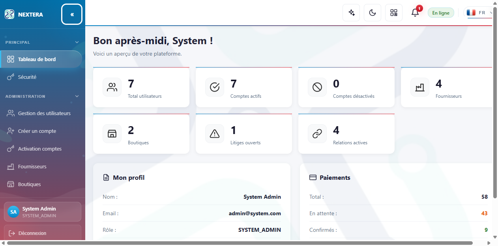

### Organisations et relations

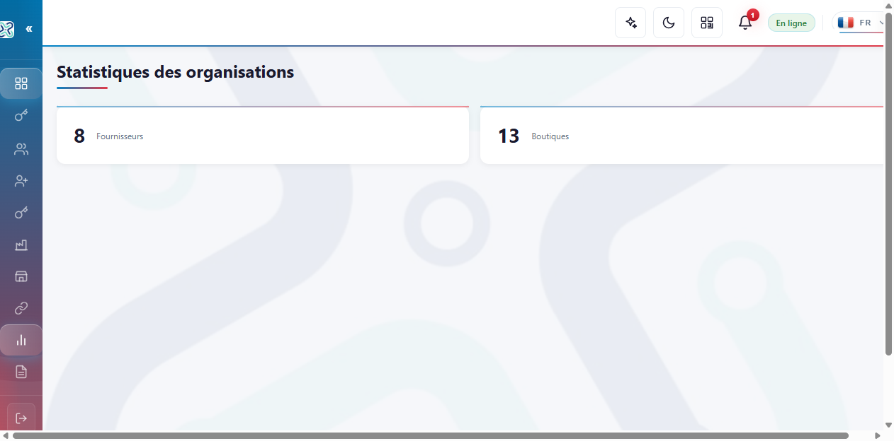

- Fournisseurs et boutiques : création, fiche, activation, profil fiscal (MF, patente, identifiant TEJ, nature de retenue par défaut).
- Relations fournisseur ↔ boutique : création, consultation, suppression.
- Utilisateurs : création, activation, désactivation.
- Journal d'audit : traçabilité des actions sensibles.

## Espace fournisseur

### Tableau de bord

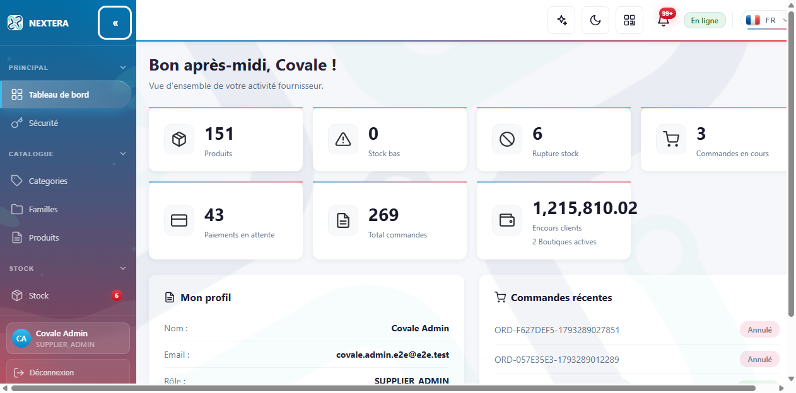

### Catalogue et produits

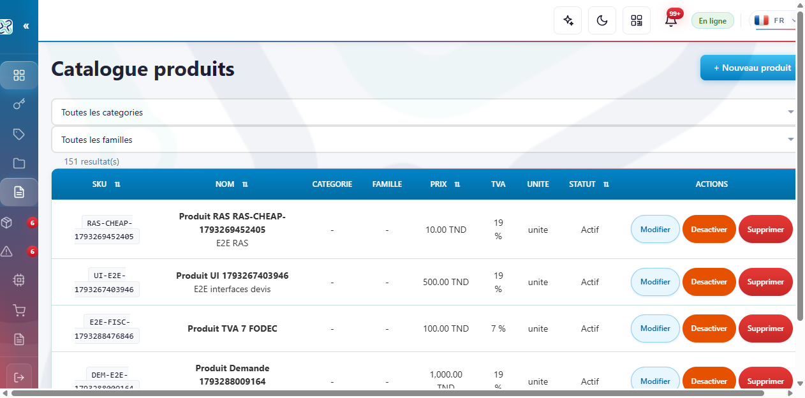

- Familles, catégories et produits.
- Prix HT ou TTC avec conversion automatique.
- TVA par produit : 19 %, 13 %, 7 % ou 0 % motivé.
- Assujettissement FODEC 1 % inclus dans la base TVA.
- SKU, unité, description, image.

### Commandes

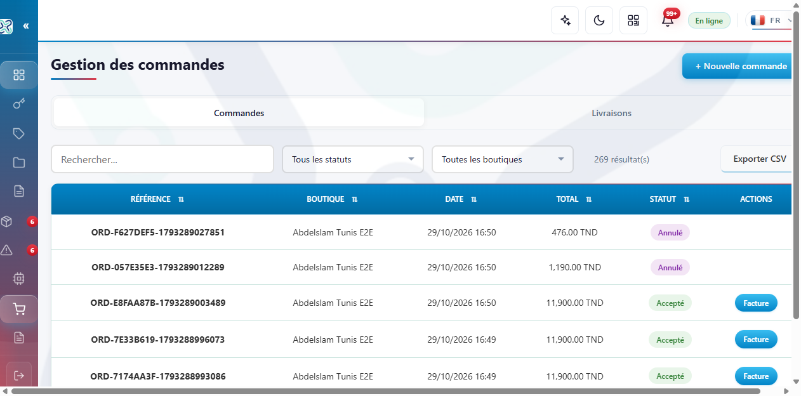

- Recherche, filtres et fiche détaillée avec événements et commentaires.
- Devis versionnés avec remises par ligne.
- Cycle complet : confirmation → préparation → prêt → livraison → réception → acceptation.
- Facture PDF, facture électronique TEIF et export CSV.

### Journal des factures

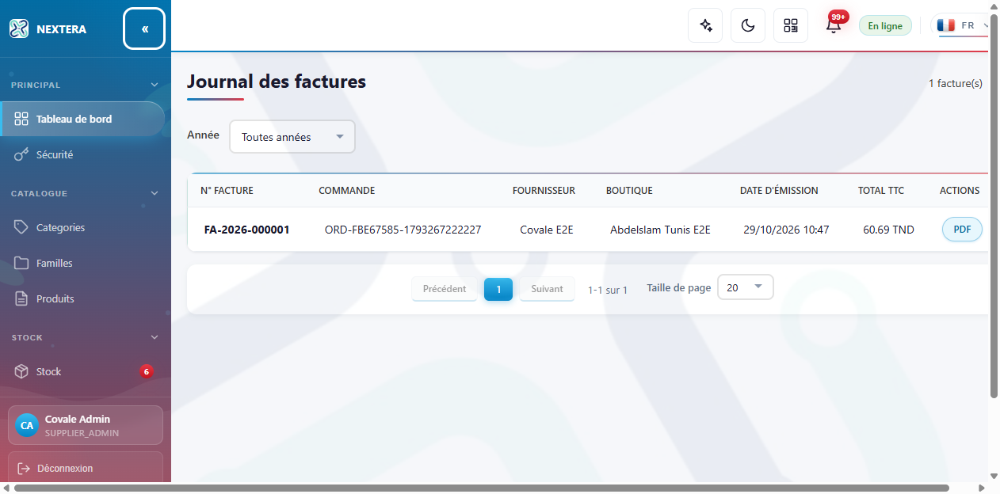

### Finances

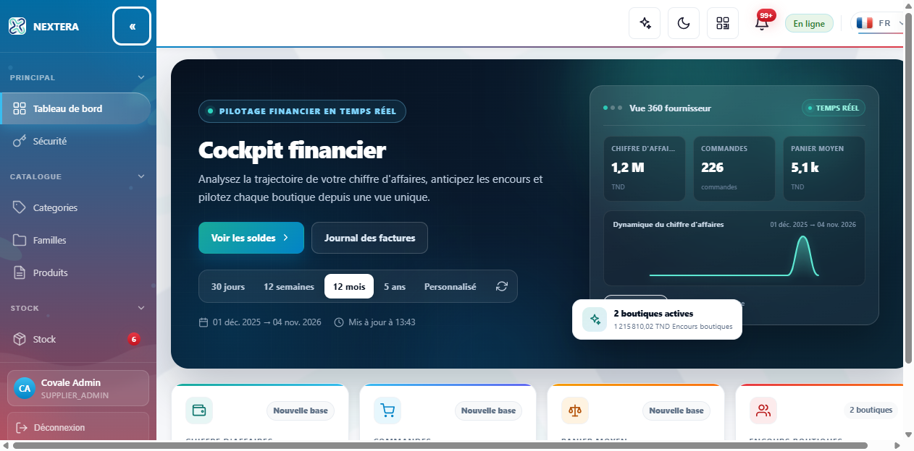

- Solde global et solde par boutique.
- Ajustements manuels et synthèse par agent.
- Chiffre d'affaires, encaissements et retenues.

### Livraisons

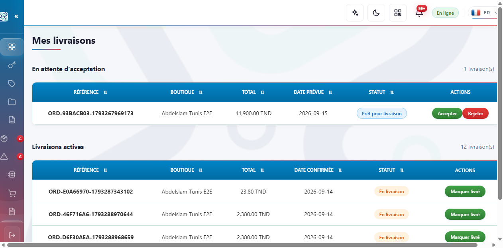

- Affectation des livreurs, livraisons du jour, suivi GPS.
- Paiement des agents.

## Espace boutique

### Tableau de bord

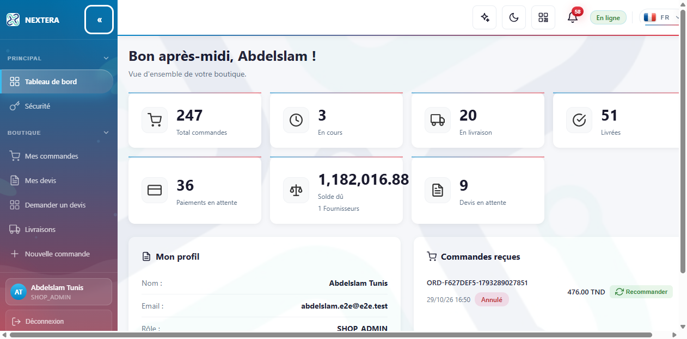

### Commandes

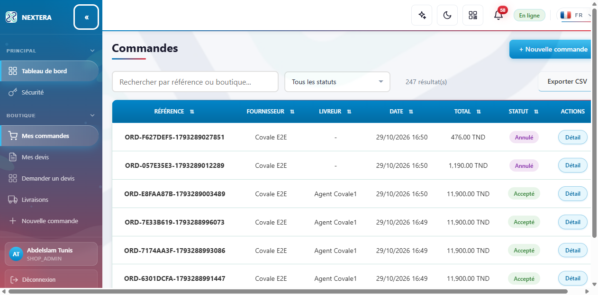

- Création manuelle ou depuis le catalogue.
- Modification de brouillon, annulation, recommandation.
- Paiement ASAP : acceptation et paiement immédiat.
- Réception : acceptation ou rejet, date et personne ayant réceptionné.

### Nouvelle commande

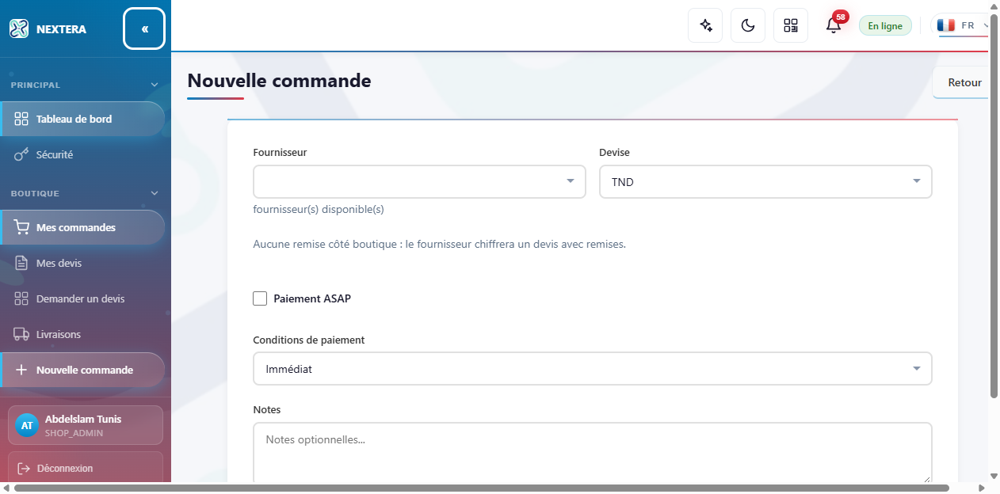

### Devis reçus

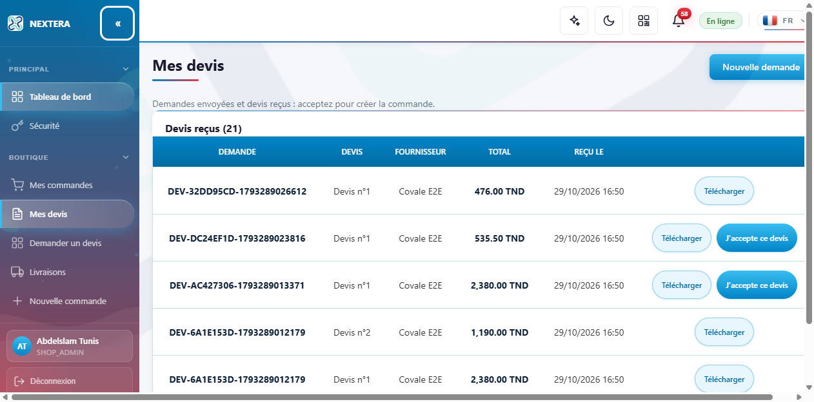

- Historique versionné par commande.
- Téléchargement PDF de chaque version.
- Notification à chaque envoi.

### Réclamations

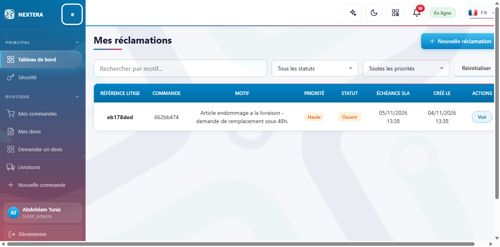

- Page unifiée `/dashboard/reclamations` pour tous les rôles métier.
- Ouverture sur n'importe quelle commande, quel que soit son statut.
- Priorités et SLA : `LOW` 7 j, `NORMAL` 72 h, `HIGH` 24 h, `URGENT` 4 h.
- Prise en charge, affectation, résolution et clôture historisées.
- Pièces jointes PDF/JPEG/PNG (5 Mo) et notes internes.

## Paiements et notifications

### Paiements

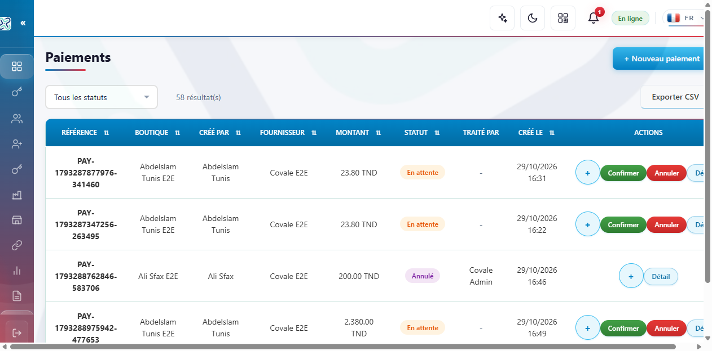

- Création manuelle ou automatique à la réception acceptée.
- Validation, rejet, annulation.
- Détection des paiements en retard et statistiques.
- Facture PDF du paiement et exports.

### Notifications temps réel

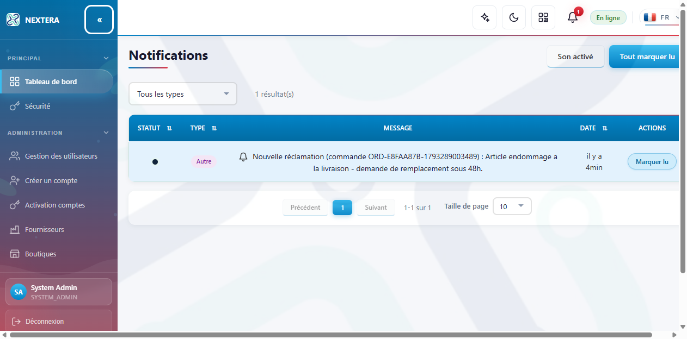

- Centre in-app avec compteur de non-lus.
- Flux SSE, push FCM et Web Push PWA.
- Messages rendus dans la langue de l'utilisateur.

## Conformité fiscale tunisienne

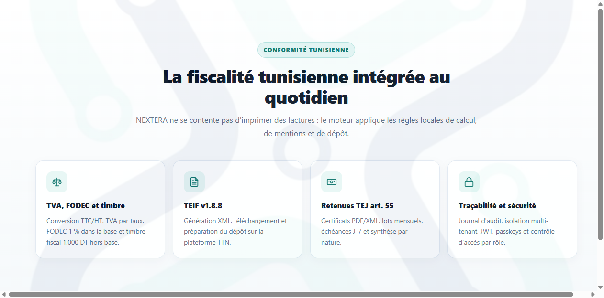

### Moteur fiscal

- Ordre de calcul : remise → **FODEC 1 %** dans la base → **TVA par taux** → TTC → **timbre 1,000 DT** hors base.
- Prix TTC avec TVA déduite, 3 décimales, ventilation par taux sur chaque facture.
- Mentions légales : article 18 (MF des deux parties, HT, taux et montants, remises, série) et article 11 pour suspension/export.
- Facture PDF pleine page, totaux insécables, signatures, QR et référence externe.

### Facture électronique TEIF v1.8.8

- Génération XML avec MF à 13 caractères, dates `jjMMAA`, codes `I-*` et timbre séparé.
- Téléchargement côté boutique et fournisseur, dépôt sur la plateforme TTN.

### Retenues à la source TEJ (article 55)

- Émission automatique à la livraison sur base TTC.
- Natures : marchandises, services, loyers, honoraires, sans MF 15 %.
- Priorité : nature explicite > défaut fournisseur > automatique.
- PDF, XML, lot mensuel XML et marquage du dépôt par référence TEJ.
- Rappel J-7 et synthèse mensuelle par nature.
- Guides intégrés pour la préparation et le dépôt.

## Sécurité

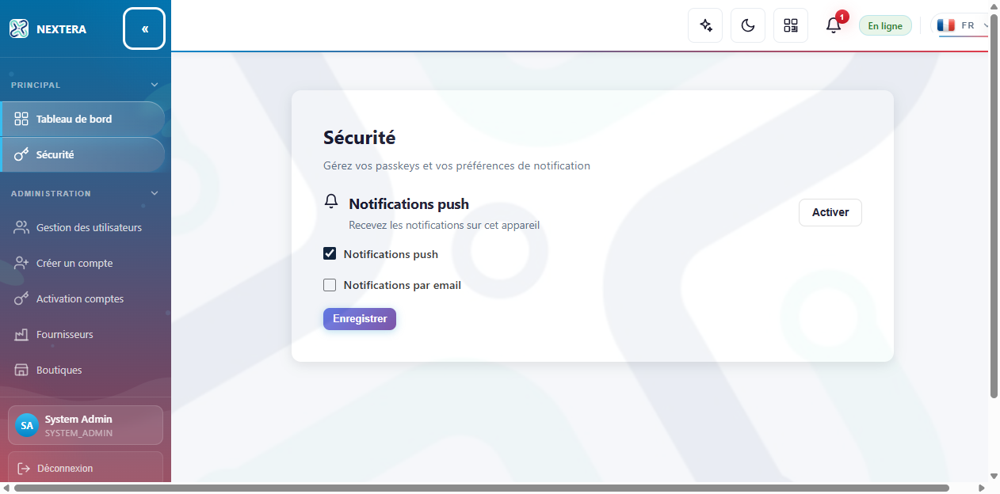

- JWT avec rafraîchissement de session et cookie HttpOnly.
- **Passkeys WebAuthn** : connexion sans mot de passe, renommage et révocation des appareils.
- Mot de passe oublié et première activation par lien.
- API Gateway : validation JWT, liste blanche IP (CIDR), limitation de débit renforcée sur l'authentification.
- Journal d'audit et idempotence sur les opérations sensibles.

## Expérience utilisateur et PWA

- **3 langues** : français, anglais et arabe avec **RTL** complet.
- Thèmes clair/sombre et accent personnalisable.
- Formats tunisiens : dates et montants TND.
- Visite guidée, toasts, dialogues de confirmation, pagination, scanner QR.
- **PWA installable** avec mise à jour et notifications Web Push.

### Application mobile

| Tableau de bord mobile | Réclamations mobile |
|---|---|
| 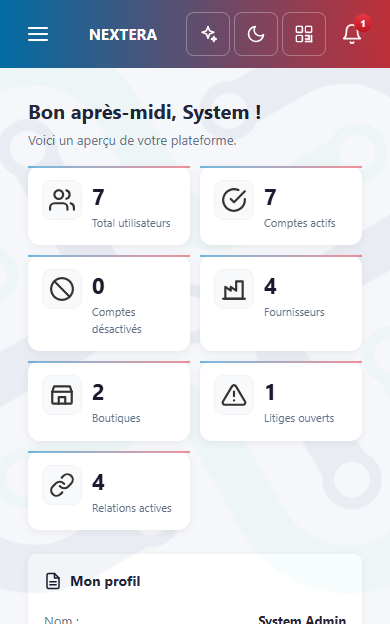 | 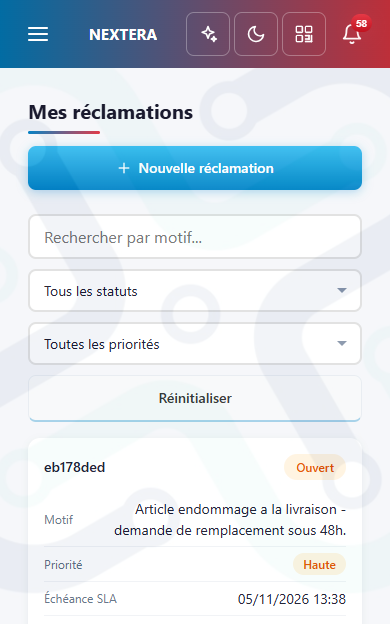 |

## Architecture

NEXTERA repose sur des microservices Spring Boot derrière une API Gateway, une application Angular 21 PWA et des applications mobiles.

- Microservices : identité, organisations/commandes/stocks, paiements, notifications.
- Communication événementielle via **RabbitMQ** (outbox), idempotence.
- Déploiement **Docker** multi-conteneurs, CI avec build, tests et E2E.
- Détails techniques : [TECHNIQUE.md](../TECHNIQUE.md) · Fonctionnalités : [FONCTIONNALITES.md](../FONCTIONNALITES.md).

## Démonstration vidéo

<video controls src="assets/video/nextera-demo.mp4" width="100%"></video>

> Si la vidéo ne s'affiche pas dans votre lecteur Markdown : [télécharger la démonstration](assets/video/nextera-demo.mp4).

## Landing publique

| Plateforme | Conformité | Aperçu produit | Solutions |
|---|---|---|---|
| 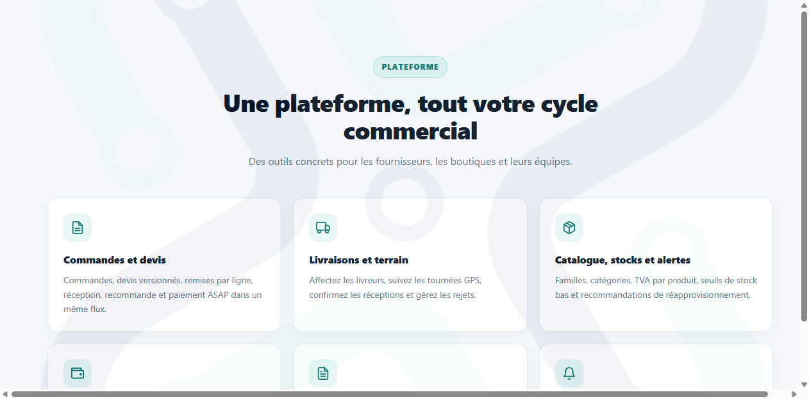 |  | 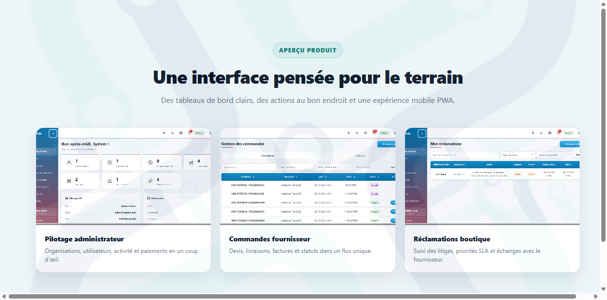 | 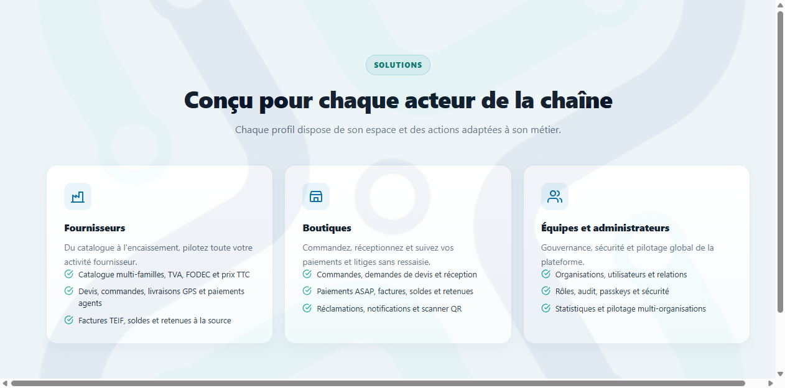 |

## En résumé

NEXTERA supprime les frictions entre fournisseurs et boutiques : un seul flux, de la commande au paiement, avec une conformité fiscale tunisienne native et une traçabilité complète.
